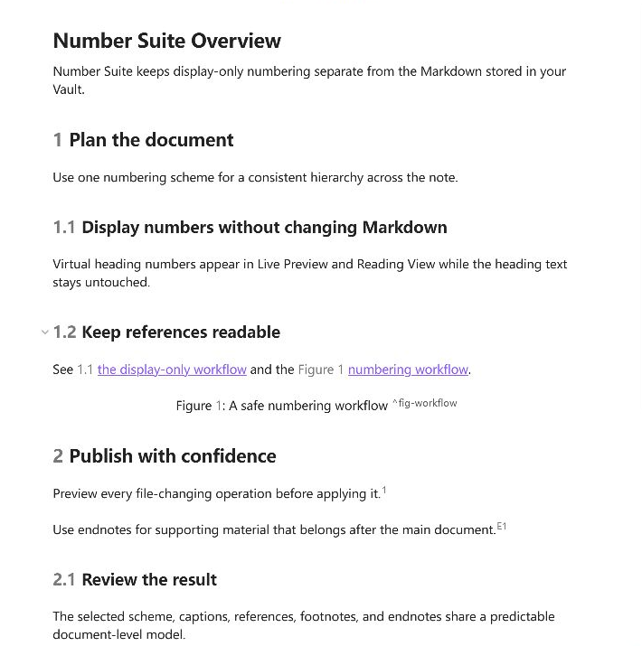
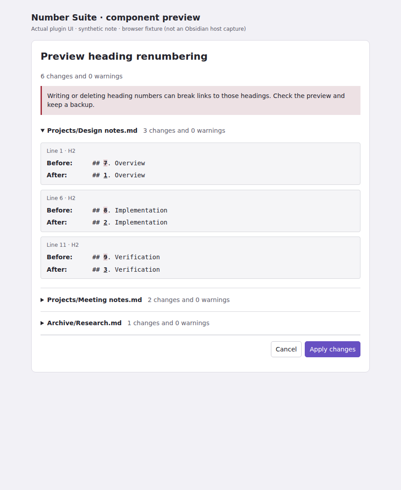

# Number Suite

[English](https://github.com/ZHYX91/obsidian-number-suite/blob/main/README.md) · [简体中文](https://github.com/ZHYX91/obsidian-number-suite/blob/main/docs/i18n/README.zh-CN.md) · [繁體中文](https://github.com/ZHYX91/obsidian-number-suite/blob/main/docs/i18n/README.zh-TW.md) · [日本語](https://github.com/ZHYX91/obsidian-number-suite/blob/main/docs/i18n/README.ja.md) · [한국어](https://github.com/ZHYX91/obsidian-number-suite/blob/main/docs/i18n/README.ko.md) · [Deutsch](https://github.com/ZHYX91/obsidian-number-suite/blob/main/docs/i18n/README.de.md) · [Français](https://github.com/ZHYX91/obsidian-number-suite/blob/main/docs/i18n/README.fr.md) · [Español](https://github.com/ZHYX91/obsidian-number-suite/blob/main/docs/i18n/README.es.md) · [Português (Brasil)](https://github.com/ZHYX91/obsidian-number-suite/blob/main/docs/i18n/README.pt-BR.md) · [Русский](https://github.com/ZHYX91/obsidian-number-suite/blob/main/docs/i18n/README.ru.md) · [Tiếng Việt](https://github.com/ZHYX91/obsidian-number-suite/blob/main/docs/i18n/README.vi.md) · [العربية](https://github.com/ZHYX91/obsidian-number-suite/blob/main/docs/i18n/README.ar.md)

Turn on **Show virtual numbers** to display heading numbers without rewriting heading text. Number Suite can also display numbers for captions, references, footnotes, and endnotes. To put heading numbers into Markdown, run **Write numbers** or **Renumber** separately, review the preview, and confirm. You can also hide numbers already written in a note without deleting them. Everything runs locally.

<!-- section: screenshots -->
## Screenshots

### See numbering without changing a note

See virtual heading numbers, caption numbers, same-file references, footnotes, and endnotes together
without changing the stored Markdown.



### Preview a batch before writing to Markdown

Expand a file to see which numbers will change and check its warnings. This example shows the batch preview with sample notes.



<!-- section: features -->
## Features

- Show calculated heading numbers in Live Preview and Reading View without changing Markdown.
- Conceal recognized stored numbers while keeping the source unchanged and accessible.
- Combine virtual display and concealment to replace one recognized stored prefix visually.
- Preview and then write, remove, or renumber headings in the current note.
- Number headings in a folder or vault after reviewing a preview. If files change after preview, the operation stops; completed batches can be undone.
- Use built-in hierarchical, Chinese official-document, and legal-document schemes.
- Create multiple custom schemes with validated H1-H9 templates and retained cleanup history.
- Use exact seven-, eight-, or nine-hash source lines as DocWen-compatible H7-H9 extensions.
- Enhance native Obsidian Outline with H1-H9 headings and Figure, Table, Equation, and Code
  captions; select an item to navigate to its source line.
- Explore the current document in a 2D heading mind map with optional structure editing. Each heading is a card whose
  left handle shows its effective number when available and whose right handle shows and toggles
  the number of direct child headings.
- Exclude an exact heading or its whole subtree without consuming a number.
- Show `Figure:`, `Table:`, `Equation:`, and `Code:` captions as filled pills, with optional
  display-only numbers. Each type counts across the note by default. In **Captions**, you can restart numbering at a chosen heading level, for example **Figure 1.2-1**.
- Center each caption type independently; Figure and Equation captions are centered by default,
  while Table and Code captions follow the current theme.
- Place each bound caption above or below its object in Live Preview and Reading View without
  rewriting Markdown; newly created captions are stored above their object.
- Show a structured hover card on an image or its Figure caption, with the rendered caption as the
  title and meaningful image replacement text as the content.
- Show explicit `@[[...]]` links to headings and captions in the same note as clickable labels, with numbers when available. Use `@[[#^block-id]]` when the block ID belongs to the heading or caption. Links to ordinary paragraph blocks keep Obsidian’s native behavior.
- Copy a stable cross-reference from a heading or caption context menu, reusing an existing block ID
  or previewing one new ID before it is created.
- Show footnotes as `1`, `2`, `3` and endnotes as `E1`, `E2`, `E3` for `[^id]`,
  `[^footnote:id]`, and `[^endnote:id]`; repeated references reuse the first number.
- Override display, concealment, scheme, starting counters, counts of initial sections to skip, or full opt-out per note.

<!-- section: requirements-and-compatibility -->
## Requirements and compatibility

- Obsidian `1.12.7` or later.
- Desktop and Android Obsidian.
- iOS behavior is not currently verified.

<!-- section: installation -->
## Installation

### Community Plugins

Open **Settings → Community plugins → Browse**, search for **Number Suite**, install it, and enable
it. If it is not available in your catalog, use the manual installation below.

### Manual installation

Download the versioned ZIP from [GitHub Releases](https://github.com/ZHYX91/obsidian-number-suite/releases), extract it, and place the `number-suite` folder inside `.obsidian/plugins/`. You can also place `main.js`, `manifest.json`, and `styles.css` from the same release in `.obsidian/plugins/number-suite/`. Reload Obsidian and enable the plugin. Do not mix files from different versions.

**Manual upgrades:** Replace only `main.js`, `manifest.json`, and `styles.css` in the existing plugin folder with files from the same release. Keep `data.json` to preserve your settings. Also keep any existing `recovery.json` and `recovery.pending.json` files: they store batch undo/recovery data. Do not overwrite or delete them during an upgrade.

<!-- section: usage -->
## Usage

To see heading numbers without rewriting the headings, enable **Show virtual numbers** under **Heading numbering**. To save numbers into Markdown for other tools, use **Write numbers** from the sidebar's **Current note** panel and review the preview before applying.

| Source state | Desired result | Action | Rewrites heading text |
|---|---|---|---|
| No stored number | Show a number only in Obsidian | Enable virtual numbers | No |
| No stored number | Save calculated numbers | Write heading numbers | Yes |
| Stored number | Hide it visually | Enable concealment | No |
| Stored number | Replace it with a calculated display number | Enable virtual numbers and concealment | No |
| Stored number | Remove it from the file | Remove heading numbers | Yes |

Current note keeps the filename, automatic status and three main choices compact, with secondary help in tooltips and advanced rules and file operations collapsed. Normal saved status takes no extra space; saving and errors remain visible. Per-note display choices save Properties in the note; the display itself does not rewrite headings.

Previews group changes and warnings by file, with counts beside each filename. Expand a file and use its load-more button to inspect all results. Disabling the plugin stops further batch changes. A note that was already saving may finish. If you edited it before Number Suite could undo that change, keep `recovery.json` in the plugin folder and check the note before trying Undo again.

The global stored-number recognition setting controls which heading prefixes can be hidden.
It offers three options: Number Suite markers only, numbers matching known schemes (the default),
or also common handwritten numbers. Each note can override whether to hide stored numbers.

The ribbon directly opens **Current note** in the persistent sidebar, with **Display & numbering** and **Edit note text** tabs. Native **Outline** shows enhanced H1-H9 headings and captions. Enable the core Outline plugin yourself; Number Suite provides guidance when disabled. Legacy commands and workspace states migrate compatibly. Single-note file-changing commands open a preview inside **Edit note text**, with a fixed target, counts and Back/Cancel/Apply. Switching notes or tabs keeps the original preview target; changed source requires a fresh preview. Back, Cancel and successful Apply return to the **Edit note text** action list. Batch previews remain wide dialogs and scheme editing stays in global settings. Writing or removing a number changes the heading
text and can invalidate `[[Note#Heading]]` links, heading embeds, or external anchors; the plugin
does not guess and rewrite those links.

Use **Open heading mind map** from the command palette or the source-bound map buttons in native Outline or Current note to open
the current Markdown note as an ordered heading tree. A file card connects all top-level headings
and remains visible even when the note has none. It shows the file name, a file icon and the number
of top-level headings; it never replaces a same-name H1. The initial overview shows the first two levels of the heading tree at a readable size. Click the file name above the map to return from a subtree, or the
zoom percentage to restore 100%. The left heading-card handle shows the virtual number that is
actually displayed, or a reliably recognized visible stored number; otherwise it falls back to the
heading level. The right arrow shows the direct-child count and toggles the branch; leaves show neither an arrow nor zero. Select a card and switch between the whole document and that heading's subtree, show 1, 2,
3, or all structural depths, and switch between left-to-right and top-to-bottom layout. Search shows
the current match count; Enter and Shift+Enter move forward and backward through matches without
changing structural counts. Drag empty space or scroll to pan, hold Ctrl/Cmd while scrolling to zoom
around the pointer, use two-finger pinch zoom on touch devices, and use +, -, 0 or the toolbar
controls for zoom/Fit. Double-click a heading card or press Enter on its body to jump to its exact
source line. The map normally browses without writing and never counts captions as child headings. Explicit **Adjust structure** mode supports same-parent, same-level whole-section dragging and up/down buttons. The mode has a visible label and move controls; highlighted targets and before/after insertion lines show the drop position. Invalid destinations and unavailable or changed source show concise reasons. Moves require unchanged source and support native Undo/Redo.

General provides a default-on Enhance native Outline switch. Turning it off removes enhancements and the map entry while retaining preferences, without enabling core Outline. Its toolbar Display options menu has four shared persistent choices: heading numbers, heading levels when unnumbered, H7–H9, and captions. These affect Outline only; existing saved off values remain off. A filled badge shows the calculated number. A separate outlined badge can show a visible number already written in the heading. If neither is shown, you can display the heading level (H1–H9). Hover identifies its level. Caption leaves keep their type icon, localized ordinal and secondary title, without pills or expand arrows. Native navigation and effective body numbering remain unchanged.

### Extended H7–H9 headings

Exact runs of seven, eight, or nine opening `#` characters extend the levels that Number Suite can number and navigate. These levels are not native Obsidian headings; use stable block IDs for links that must also work outside the plugin.

### Captions and objects

Write a standalone `Figure:`, `Table:`, `Equation:`, or `Code:` caption beside its object. Displaying its number or moving a bound caption visually does not rewrite the note; explicitly creating or relocating a caption does. Ambiguous object bindings remain unbound rather than guessed.

### Same-file cross references

Use `@[[#Heading]]` or `@[[#Figure: Architecture]]` for a display-only reference within the current note. **Copy cross-reference** can reuse a stable block ID or offer one carefully previewed write before creating it. Ordinary Wiki heading numbering is separately opt-in and off by default. When enabled, same-file `[[#Heading]]` and `[[Note#Heading]]` links gain inert number labels in Live Preview and Reading View while keeping aliases and native interactions. Cross-file, block, embed and ordinary Markdown links are excluded. Single-click explicit references to navigate; use F2 or the mobile source-edit action to edit their source.

### Footnotes and endnotes

`[^id]` / `[^footnote:id]` and `[^endnote:id]` have separate display counters. Display-only numbering does not rewrite their definitions.

For exact syntax, object-placement ambiguity, IDs and editor behavior, read the [advanced numbering, captions and references guide](https://github.com/ZHYX91/obsidian-number-suite/blob/main/docs/advanced.md).

<!-- section: settings -->
## Settings

Open **Settings → Number Suite → General** for the **User guide** and **Report an issue** links.

The seven settings tabs are General, Heading numbering, Captions, Links & references, Footnotes & endnotes, Write and cleanup, and Display & appearance. Open **Write and cleanup** to change batch options.

**Exporting to Word:** Number Suite uses optional Markdown extensions for captions, references, H7–H9 headings, and typed endnotes. [DocWen Assistant](https://github.com/ZHYX91/obsidian-docwen-assistant) can export through a separately installed local DocWen application on Windows/Linux desktop. Enable the needed **input** extensions in **DocWen → Settings → Parse Markdown**; Word-export numbering follows DocWen's selected conversion options, not necessarily the numbers visible in Obsidian.

### Numbering schemes

The selected scheme controls both virtual display and any later file operation, but **selecting a scheme does not write to the note**. The display updates immediately only where virtual numbering is enabled. Writing or renumbering still requires a separate command, preview, and confirmation.

Alongside the existing hierarchical, Chinese-official and legal schemes, there are optional Traditional Chinese, Japanese, Korean and Arabic-Indic chapter/section styles. These are **examples of writing conventions, not national standards for every document**. The plugin may suggest a scheme based on interface language, but never silently selects it, and changing interface language never changes your scheme. You can choose any scheme regardless of interface language.

In the template editor, `arabic` still means the familiar Western digits `1, 2, 3`; use `arabic_indic` for `١، ٢، ٣`. Traditional Chinese has separate `chinese_traditional_lower` and `chinese_traditional_upper` formats. All styles can be previewed before use.

Templates use `{heading-level.number-format}` placeholders, such as `{1.arabic}` or
`{2.chinese_lower}`. Supported formats are Arabic, full-width Arabic, lower/upper Chinese, circled,
upper/lower Latin letters, and upper/lower Roman numerals.

An empty Hn template does not output a number, but that heading remains structural: it increments
its counter, resets deeper counters, and can be referenced by descendant templates. A non-empty Hn
template must include an Hn placeholder and must not reference a deeper heading level. Each heading level uses its own template. Templates must be single-line, must not
start with whitespace, and must not contain HTML comments or U+2060 source markers. A bare letter or
Roman-numeral counter is rejected unless the template adds an explicit delimiter, such as
`{1.letter_lower}.`.

Custom schemes may exclude exact logical heading titles. A whole-subtree exclusion skips the
heading and all descendants; a heading-only exclusion leaves descendants to the selected
skipped-level strategy. Exclusions do not use fuzzy matching or regular expressions.

### Cleanup and source markers

The cleanup preview starts from the saved default scope and lets you choose source markers, known
templates, or the broader common-manual-number scope for that operation. Ambiguous decimals,
versions, years, dates, and measurement-like prefixes are preserved by default.

Optional U+2060 source markers make plugin-written numbers exact to identify. They are experimental
and disabled by default because invisible characters can affect interoperability, copied text, and
heading links. A dedicated command removes markers while retaining visible numbers.

### Per-note Properties

Current note offers independent inheritance for virtual numbers, stored-number visibility and scheme, with an automatic status. Under **Starts & skips**, add a rule for the heading level you want to change. **Remove rule** clears every field for that level. The header menu can disable the note while retaining overrides. **Edit note text** contains write and cleanup actions with previews. Untouched notes receive no
plugin Properties. Returning a control to **Follow global** deletes that property; **Restore all**
removes every Number Suite override and preserves unrelated Properties.

```yaml
---
number-suite:
  - heading.virtual=true
  - heading.hide-stored=true
  - heading.scheme=hierarchical-h2
  - heading.first-number.h2=4
  - heading.skip-first.h2=1
  - heading.skip-per-parent.h2=1
---
```

In this example, `heading.skip-first.h2=1` picks the first non-empty H2 in the note. `heading.skip-per-parent.h2=1` picks the first non-empty H2 under each H1. When they pick the same section, it is skipped once with all its subheadings. The next H2 under the first H1 is `4` and its first H3 is `4.1`.

H1 has only the note-wide count. For H2–H9, the nearest preceding heading of a higher level is the parent, or the note itself if none exists. Each parent starts its own count. Both rules count headings in source order, including headings inside sections already skipped. Skipped headings receive no number and do not advance numbering.
Use `number-suite: [disabled=true]` to opt the note out of display and file operations. Cleanup
scope is deliberately not note metadata; choose it in each cleanup or renumber preview.

Legacy Number Suite Properties remain readable. An explicit change in Current note migrates that
note to the canonical list and removes only the old Number Suite fields. Equivalent old/new values
are accepted; conflicts, duplicate directives, unknown directives, invalid values, and unavailable
schemes fail closed.

Current-note number fields keep a local draft while you type and commit a valid value on Enter or when leaving the field.
Failed input remains available for Retry, and outline navigation stays in the originating pane.

<!-- section: limitations -->
## Limitations

- One Markdown file has one effective numbering scheme; section-local scheme switching is not
  supported.
- Caption counters and semantic-reference resolution are also scoped to one Markdown file. Embedded
  files use their own source and counters; cross-file semantic references are not recognized.
- When using DocWen, caption labels and the object they describe remain distinct: for example,
  a `Figure:` caption can describe a table while the table remains a table in Word. The resulting
  document depends on the selected conversion options and should be reviewed before sharing.
- Footnote and endnote counters are independent and file-scoped. Obsidian still owns note anchors,
  navigation, layout, and definition rendering; the plugin changes only validated visible labels.
- Top-level ATX H1-H6 plus Number Suite/DocWen H7-H9 extension headings are handled. Setext
  headings, blockquotes, lists, comments, frontmatter, fenced code, and HTML blocks are not
  numbering targets. Native Obsidian heading indexes remain limited to their own supported syntax.
- Headings and captions inside lists or blockquotes do not enter document numbering. Ordinary
  footnote and cross-reference links in their text still work; fenced code examples stay unchanged.
- Canvas, Backlinks, Search Results, and PDF export integration are not
  supported. Number Suite enhances native Outline for H1-H9 and captions.
- Source Mode decorations are disabled by default so stored Markdown remains directly visible.
- Reading View concealment changes visible text, not the heading DOM `id`; anchors still follow the
  stored heading.
- If a third-party renderer changes heading count or levels, Reading View fails closed for that
  section.

<!-- section: privacy-and-security -->
## Privacy and security

Number Suite runs locally and contains no networking, telemetry, analytics, advertisements,
remote fonts, or remote assets. Virtual display and concealment never call file-write APIs.

Opening a batch tool enumerates the Vault's folder tree and Markdown file list so Number Suite can
filter the chosen scope, exclude configured folders, and produce an exact preview before writing.

Current-note heading transforms use one editor transaction. Per-note settings are saved separately in Properties. Batch operations preview all targets, revalidate
their exact content, persist bounded recovery data, and avoid overwriting concurrent edits. These
safeguards stop the plugin from applying an outdated preview. Keep your usual backups when making changes across many notes.

Report security or data-loss concerns through [GitHub Security Advisories](https://github.com/ZHYX91/obsidian-number-suite/blob/main/SECURITY.md) without
including private vault content.

<!-- section: development -->
## Development

Use Node.js `24.19.0` and npm `11.17.0`.

```bash
npm ci
npm run check
```

Project documents:

- [Product requirements](https://github.com/ZHYX91/obsidian-number-suite/blob/main/docs/product-requirements.md)
- [UX specification](https://github.com/ZHYX91/obsidian-number-suite/blob/main/docs/ux-spec.md)
- [Architecture](https://github.com/ZHYX91/obsidian-number-suite/blob/main/docs/architecture.md)
- [Testing strategy](https://github.com/ZHYX91/obsidian-number-suite/blob/main/docs/testing-strategy.md)

Project links:

- [Contributing guide](https://github.com/ZHYX91/obsidian-number-suite/blob/main/CONTRIBUTING.md)
- [Security policy](https://github.com/ZHYX91/obsidian-number-suite/blob/main/SECURITY.md)
- [Changelog](https://github.com/ZHYX91/obsidian-number-suite/blob/main/CHANGELOG.md)

<!-- section: support -->
## Support

- [Q&A](https://github.com/ZHYX91/obsidian-number-suite/discussions/categories/q-a): Usage and configuration questions.
- [Ideas](https://github.com/ZHYX91/obsidian-number-suite/discussions/categories/ideas): Early feature and workflow ideas.
- [Show and tell](https://github.com/ZHYX91/obsidian-number-suite/discussions/categories/show-and-tell): Tips, workflows, and reference implementations.

Use [GitHub Issues](https://github.com/ZHYX91/obsidian-number-suite/issues/new/choose) for reproducible bugs
and feature requests. Include plugin and Obsidian versions, operating system, minimal synthetic
Markdown, the selected scheme, and the exact action taken. Do not attach private vault content.

<!-- section: license -->
## License

[MIT](https://github.com/ZHYX91/obsidian-number-suite/blob/main/LICENSE)
